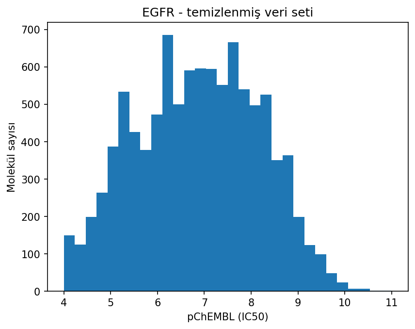

# EGFR QSAR with Scaffold Split

Ligand-based QSAR models that predict the potency of EGFR inhibitors (pChEMBL, derived from IC50) from molecular structure, evaluated with a **Murcko scaffold split** to avoid the over-optimistic scores that a random split produces on chemically clustered data.

> **Status: in progress.** Data cleaning, scaffold split, fingerprints and a Random Forest baseline are complete. XGBoost, the random-vs-scaffold comparison and a Streamlit app are planned (see [Roadmap](#roadmap)).

---

## Table of contents

1. [Motivation](#motivation)
2. [Key concepts](#key-concepts)
3. [Pipeline overview](#pipeline-overview)
4. [Data](#data)
5. [Data cleaning and quality report](#data-cleaning-and-quality-report)
6. [Scaffold split](#scaffold-split)
7. [Features](#features)
8. [Models and results](#models-and-results)
9. [Limitations](#limitations)
10. [Roadmap](#roadmap)
11. [Installation and usage](#installation-and-usage)
12. [Repository structure](#repository-structure)
13. [License and data attribution](#license-and-data-attribution)

---

## Motivation

The epidermal growth factor receptor (EGFR) is a well-studied kinase and a classic target in cancer drug discovery. Testing every candidate molecule in the lab is expensive, so computational models are used to prioritise which compounds are worth testing.

A QSAR (quantitative structure-activity relationship) model learns the relationship between a molecule's structure and its measured activity from compounds that have already been tested. This project builds such a model for EGFR as an introduction to ligand-based computer-aided drug design (CADD).

The main methodological point of the project is the **evaluation**: medicinal chemistry datasets contain many close analogues of the same chemical series. If those analogues end up on both sides of a random train/test split, the model is rewarded for memorising a series rather than generalising to new chemistry. A scaffold split keeps entire chemical series on one side.

## Key concepts

| Term | Meaning in this project |
|---|---|
| **IC50** | Concentration (nM) of a compound needed to inhibit the target by 50%. Lower = more potent. |
| **pChEMBL** | `-log10(IC50 in molar)`, i.e. `9 - log10(IC50 in nM)`. Higher = more potent. One unit equals a 10-fold change in IC50. This is the regression target. |
| **SMILES** | Text representation of a molecule (e.g. `CCO` for ethanol). |
| **Morgan fingerprint** | Binary vector (here 2048 bits, radius 2) that marks which circular substructures are present in a molecule. |
| **Murcko scaffold** | The ring system plus linkers of a molecule, with side chains removed. Used to group molecules into chemical series. |
| **Scaffold split** | Train/test split in which no scaffold appears in both sets. |
| **R², RMSE** | R² = 1 is perfect, 0 equals predicting the test mean, negative is worse than that. RMSE is the average error in pChEMBL units. |

## Pipeline overview

```
ChEMBL CSV (CHEMBL203, IC50)
        |
        v
  clean.py        activity filters, salt stripping, de-duplication, quality report
        |
        v
  split.py        Murcko scaffold split (70 / 30)
        |
        v
  features.py     Morgan fingerprints (radius 2, 2048 bits)
        |
        v
  train_rf.py     Random Forest vs. mean-predictor baseline
  compare.py      XGBoost, random vs. scaffold split comparison
```

## Data

- **Source:** ChEMBL, target `CHEMBL203` (EGFR, *Homo sapiens*), activities exported as CSV from the ChEMBL web interface.
- **Raw size:** 26,600 records, 49 columns.
- The raw file is **not included** in this repository. See [Installation and usage](#installation-and-usage) for how to obtain it.

## Data cleaning and quality report

`src/clean.py` applies the filters below in order and logs how many records remain after each step. The full report is written to `reports/data_quality_report.txt`.

| Step | Records remaining |
|---|---|
| Raw export | 26,600 |
| Target = CHEMBL203 | 26,600 |
| Standard type = IC50 | 26,600 |
| Standard relation = `=` (drops `>` and `<` censored values) | 19,719 |
| Standard units = nM | 19,646 |
| pChEMBL value present | 19,378 |
| No data validity comment | 19,378 |
| Not flagged as potential duplicate | 17,272 |
| Wild-type assays only (no variant mutation annotation) | 13,459 |
| SMILES present | 13,442 |
| Valid SMILES after standardisation | 13,442 |
| **Unique molecules after merging duplicates (median)** | **9,897** |

Molecule standardisation (RDKit `rdMolStandardize`):

- Keep the largest fragment (removes salts and solvents). 264 records contained multiple fragments.
- Neutralise charges.
- Generate canonical SMILES. No invalid SMILES were found.

De-duplication: measurements of the same canonical SMILES are merged into one row using the **median** pChEMBL, which is robust to outlying measurements. 3,545 duplicate records were merged. 413 molecules have a standard deviation above 1 pChEMBL unit across their measurements (kept, flagged for later analysis).

Design decisions worth noting:

- **Mutant assays are excluded.** EGFR has clinically important mutants (e.g. L858R, T790M) whose activity profiles differ from wild type; mixing them would give the same molecule conflicting labels. Assays without a variant annotation are assumed to be wild type, which is an assumption, not a guarantee.
- **Censored values (`>`, `<`) are excluded** because they give bounds rather than values.

Final pChEMBL distribution: median 6.90, min 4.00, max 11.00.



## Scaffold split

`src/split.py` computes the Murcko scaffold of each molecule, groups molecules by scaffold, and assigns whole groups to either train or test. Larger scaffold groups are placed in train first, so the test set is made up of rarer scaffolds, which is a deliberately demanding setting.

| | Value |
|---|---|
| Molecules | 9,897 |
| Distinct scaffolds | 3,533 |
| Train | 6,927 (70%) |
| Test | 2,970 (30%) |
| Scaffolds shared between train and test | **0** |
| Mean pChEMBL, train / test | 6.92 / 6.73 |

The script checks and prints the number of shared scaffolds so that leakage would be visible.

## Features

`src/features.py` converts each cleaned SMILES into a 2048-bit Morgan fingerprint (radius 2) using RDKit's `rdFingerprintGenerator`. Fingerprints are computed independently per molecule and learn nothing from the data, so computing them does not leak information between train and test.

`src/fingerprint_demo.py` is a small demonstration on ethanol, propanol and benzene showing that related molecules switch on overlapping bits while structurally different ones do not.

## Models and results

Test set: 2,970 molecules with scaffolds absent from training.

| Model | R² | RMSE (pChEMBL units) |
|---|---|---|
| Baseline (always predicts train mean) | -0.023 | 1.295 |
| Random Forest (300 trees, Morgan 2048) | 0.446 | 0.953 |
| XGBoost | _pending_ | _pending_ |

An RMSE of about 0.95 corresponds to a typical error of roughly 9-fold in IC50, on scaffolds the model has never seen. The Random Forest reduces the baseline error by about 26%.

### Random split vs. scaffold split

_Pending: the same models trained on a random 70/30 split of the same molecules, to quantify how much a random split inflates performance._ (`src/compare.py`)

| Model | Random split R² | Scaffold split R² |
|---|---|---|
| Random Forest | _pending_ | 0.446 |
| XGBoost | _pending_ | _pending_ |

## Limitations

- Labels are **IC50 values aggregated from many assays and laboratories**; inter-assay variability limits the achievable accuracy.
- Models use a single representation (Morgan fingerprints) and little hyperparameter tuning so far.
- The wild-type filter relies on the ChEMBL variant annotation, which may be missing for some mutant assays.
- Scaffold split is one of several possible out-of-distribution evaluations; results depend on how scaffold groups are assigned.
- This is a ligand-based model: it uses no information about the protein structure and cannot extrapolate far outside the chemical space of the training data.

## Roadmap

- [x] Data cleaning pipeline and quality report
- [x] Murcko scaffold split with leakage check
- [x] Morgan fingerprints
- [x] Random Forest baseline
- [ ] XGBoost model
- [ ] Random split vs. scaffold split comparison
- [ ] Predicted-vs-actual and residual plots
- [ ] Hyperparameter tuning with scaffold-grouped cross-validation
- [ ] Effect of removing molecules with inconsistent measurements (std > 1)
- [ ] Streamlit app (SMILES in, predicted pChEMBL out)

## Installation and usage

Tested on Windows with PowerShell and Python 3.

```powershell
git clone https://github.com/YOUR_USERNAME/egfr-qsar-scaffold-split.git
cd egfr-qsar-scaffold-split

python -m venv qsar-env
qsar-env\Scripts\activate
pip install rdkit scikit-learn xgboost pandas matplotlib seaborn streamlit joblib
```

**Get the data.** The raw data is not versioned here. From the ChEMBL web interface, open target `CHEMBL203` (EGFR), export the IC50 bioactivities as CSV, and save the file as `data/egfr_raw.csv`.

**Run the pipeline** from the repository root:

```powershell
python src/clean.py        # cleaning + reports/data_quality_report.txt
python src/split.py        # scaffold split -> data/train.csv, data/test.csv
python src/features.py     # fingerprints -> data/X_*.npy, data/y_*.npy
python src/train_rf.py     # baseline + Random Forest
python src/compare.py      # XGBoost and random vs. scaffold comparison
```

## Repository structure

```
.
├── src/
│   ├── clean.py               # filtering, standardisation, de-duplication, report
│   ├── split.py               # Murcko scaffold split
│   ├── features.py            # Morgan fingerprints
│   ├── fingerprint_demo.py    # fingerprint demo on three small molecules
│   ├── train_rf.py            # baseline and Random Forest
│   └── compare.py             # XGBoost and split comparison
├── reports/
│   ├── data_quality_report.txt
│   └── pchembl_hist.png
├── data/                      # not tracked (see Data)
├── LICENSE
└── README.md
```

## License and data attribution

Code is released under the MIT License (see `LICENSE`). The bioactivity data comes from [ChEMBL](https://www.ebi.ac.uk/chembl/) and is subject to ChEMBL's own license and terms of use; it is not redistributed in this repository.
